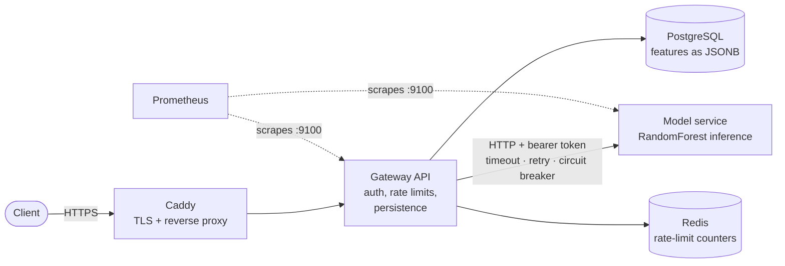

# Machine Risk Prediction System

Classifies industrial machines as **Low**, **Medium** or **High** risk from live telemetry.
Built as two FastAPI microservices that talk over HTTP with timeouts, retries and a circuit
breaker, and packaged as a production stack with HTTPS, PostgreSQL, Redis, Prometheus metrics
and CI.



## Highlights

| Area | What is implemented |
|---|---|
| **Model** | `RandomForestClassifier` tuned with `GridSearchCV` over **5-fold `StratifiedKFold`**, macro-F1 scoring, evaluated once on a 20% hold-out split |
| **Microservices** | Gateway ↔ model service over HTTP with connect/read **timeouts**, **retries** with exponential backoff and jitter, and a thread-safe **circuit breaker** (closed → open → half-open) |
| **Flexible schema** | Raw telemetry is stored as **JSON/JSONB**, so new inputs such as `humidity_pct` are saved without a database migration |
| **Drift checks** | Every model carries a feature contract. Changes that would break clients (new required input, type change, removed category, narrowed range, changed classes) are **blocked** in CI and on hot reload. PSI data-drift report included |
| **Observability** | `X-Request-ID` tracing across both services, JSON logs, Prometheus metrics on an internal-only port |
| **Security** | Argon2id passwords, JWT with pinned algorithm, per-user data isolation, admin role, rate limiting, strict input validation, security headers, CORS allow-list, docs and debug off in production, hash-locked dependencies |
| **Delivery** | 90 automated tests, GitHub Actions (lint, Bandit, pip-audit, gitleaks, PostgreSQL migrations, Docker smoke test), Docker Compose with Caddy auto-HTTPS |

## Model results

Measured on the bundled **synthetic** dataset (6,000 rows, seed 42; hold-out = 1,200 rows).
Real plant data is confidential, so `ml/data.py` generates telemetry with a known risk
mechanism plus sensor noise. Train on your own CSV with `python -m ml.train --data file.csv`.

| Class | Precision | Recall | F1 |
|---|---|---|---|
| Low | 0.911 | 0.837 | 0.872 |
| Medium | 0.622 | 0.717 | 0.666 |
| High | 0.774 | 0.754 | 0.764 |

5-fold CV macro-F1 0.794 · hold-out accuracy 0.784 · best params `n_estimators=300, max_depth=14,
min_samples_leaf=4, max_features="sqrt"`. Medium is the hardest class because it sits between
the other two. Re-run `make train` to reproduce these numbers.

## Quick start (Docker)

Requirements: Docker with Compose v2.

```bash
python3 scripts/generate_env.py              # .env with random secrets (chmod 600, git-ignored)
docker compose up -d --build --wait          # trains the model during the image build (~3 min)
curl -k https://localhost/health             # {"status":"ok"}
```

Create the first admin (the password is prompted for, never passed on the command line):

```bash
docker compose exec gateway python -m gateway.cli create-admin --email you@example.com
```

Optional Prometheus (bound to 127.0.0.1 only): `docker compose --profile monitoring up -d`.

### Deploying to a server

1. Point a DNS record (e.g. `risk.example.com`) at the server and open ports 80/443.
2. `python3 scripts/generate_env.py --domain risk.example.com --cors https://app.example.com`
3. `docker compose up -d --build --wait`. Caddy fetches a Let's Encrypt certificate automatically.

Only Caddy publishes ports. The gateway, model service, PostgreSQL and Redis sit on Docker
networks; the backend network is `internal` (no internet access).

## API

| Method | Path | Auth | Description |
|---|---|---|---|
| POST | `/api/v1/auth/register` | – | Create an account (password ≥ 12 chars) |
| POST | `/api/v1/auth/login` | – | Returns a 30-minute bearer token |
| GET | `/api/v1/auth/me` | user | Current user |
| POST | `/api/v1/predictions` | user | Score a machine and store the result |
| GET | `/api/v1/predictions` | user | Your predictions (`machine_id`, `risk_level`, `limit`, `offset`) |
| GET / DELETE | `/api/v1/predictions/{id}` | user (owner only) | Read or delete one of your predictions |
| GET | `/api/v1/admin/stats` | admin | Counts, breaker state, model metrics |
| GET / PATCH | `/api/v1/admin/users[/{id}]` | admin | List users, change role or deactivate |
| POST | `/api/v1/admin/model/reload` | admin | Hot-reload the model (blocked if incompatible) |
| GET | `/health`, `/ready` | – | Liveness and readiness |

```bash
TOKEN=$(curl -sk https://localhost/api/v1/auth/login -H 'Content-Type: application/json' \
  -d '{"email":"you@example.com","password":"your-long-password"}' | jq -r .access_token)

curl -sk https://localhost/api/v1/predictions -H "Authorization: Bearer $TOKEN" \
  -H 'Content-Type: application/json' -d '{
    "machine_id": "press-07",
    "features": {"machine_type": "press", "temperature_c": 88, "vibration_mm_s": 7.5,
                 "pressure_bar": 10.1, "rpm": 1210, "operating_hours": 11000,
                 "load_pct": 93, "humidity_pct": 61}}'
```

`humidity_pct` is not used by the current model: it is stored with the prediction and reported
in the model service's `ignored_features`, ready for the next model version.

Interactive docs are disabled in production. Set `ENABLE_DOCS=true` locally to get `/docs`.

## Schema evolution and drift checks

```bash
python -m ml.train --synthetic 6000 --with-humidity --out artifacts   # humidity as an optional input
python -m ml.drift_check --baseline ml/baseline_contract.json --candidate artifacts/contract.json
# WARN   humidity_pct: new optional feature added
# candidate contract is compatible            (exit 0; a breaking change exits 1)
python -m ml.drift_check --baseline ml/baseline_contract.json --candidate artifacts/contract.json --data new_batch.csv
# DRIFT  rpm              psi=0.0067 (ok)
# DRIFT  temperature_c    psi=1.1877 (alert)    # batch shifted by +12 °C; PSI per feature
```

The model service runs the same check on `POST /v1/admin/reload` and answers **409** instead of
swapping in an incompatible model. Model files are loaded only if their SHA-256 matches the
manifest written by the training job.

## Development

```bash
make install && source .venv/bin/activate
make test     # 90 tests: ML, model service, gateway (SQLite in-memory)
make lint     # ruff
make audit    # bandit + pip-audit
```

The tests run the gateway against the **real** model-service app in-process, plus scripted
transports for the failure modes (timeouts, 5xx, connection refused, open circuit).

```
ml/                     training, feature contract, drift check (+ tests)
services/model-service/ inference API (FastAPI)
services/gateway/       public API, auth, persistence, Alembic migrations
deploy/                 Caddyfile, Postgres init script, Prometheus config
scripts/generate_env.py random secrets for .env
```

## Configuration

All configuration is read from environment variables (see `.env.example`). The services refuse to
start if a secret is shorter than 32 characters or looks like a placeholder, or if
`CORS_ORIGINS` contains `*`.

## Licence

MIT. See [LICENSE](LICENSE). Security notes: [SECURITY.md](SECURITY.md).
